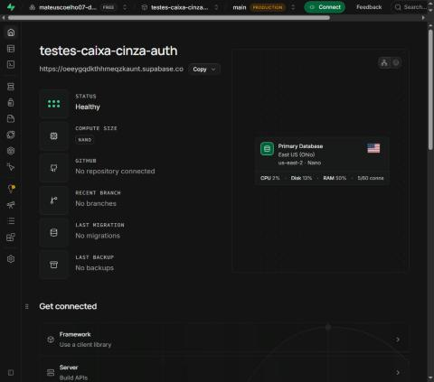

# Testes Caixa Cinza em API de Autenticação (Supabase + Postman)

> **Aluno:** Mateus Coelho Cardoso — **RA:** 250855

> ⚠️ **Antes de entregar:** procure por `<PREENCHER>` / `TODO` neste arquivo e substitua pelos dados e prints reais produzidos por você. Nada aqui deve ser copiado de terceiros.

## Estrutura do repositório

```
/README.md
/postman/    -> collection e environment exportados do Postman
/prints/     -> evidências (prints reais)
/planilha/   -> registro_testes.csv (planilha de testes)
```

# Introdução

Este projeto documenta a execução de testes funcionais **caixa cinza** sobre a API de autenticação do **Supabase** (GoTrue), usando o **Postman Desktop**. No teste caixa cinza o testador conhece parcialmente o sistema (endpoint, headers, formato do body e respostas HTTP), mas não o código-fonte interno. Nenhuma interface gráfica foi implementada.

# Objetivo da Atividade

- Configurar um ambiente de autenticação por e-mail no Supabase e criar um usuário de teste.
- Configurar Workspace, Environment e variáveis no Postman.
- Criar e executar requisições HTTP de login e validar status, JSON, mensagens de erro e `access_token`.
- Registrar os testes em planilha e documentar todo o processo.

# Configuração do Supabase

**Como o projeto foi criado:** acessei https://supabase.com, criei minha conta, e em *New project* criei o projeto `testes-caixa-cinza-auth` (região East US, Ohio). `<PREENCHER com o seu relato>`

**Tipo de autenticação:** e-mail e senha (*Authentication → Providers → Email* habilitado). Para facilitar o teste, a confirmação de e-mail foi `<desativada / usuário confirmado manualmente>`.

**Como o usuário foi criado:** em *Authentication → Users → Add user → Create new user*, informando e-mail e senha de teste e marcando *Auto Confirm User*.

**Credenciais da API** (*Project Settings → API*): `Project URL` (→ `base_url`) e a chave `anon public` (→ `api_key`). Por segurança, a chave completa **não** está exposta neste README.

**Objetivo:** ter um backend de autenticação real, com usuário válido, para testar a API.

**Evidências (prints reais, com minha identificação visível):**

| Evidência | Arquivo |
|---|---|
| Projeto criado | `prints/01-projeto-criado.jpg` |
| Painel do Supabase | `prints/02-painel.jpg` |
| Autenticação habilitada | `prints/03-auth-habilitada.jpg` |
| Usuário criado | `prints/04-usuario-criado.jpg` |
| Credenciais da API (chave parcialmente oculta) | `prints/05-credenciais-api.jpg` |
| Identificação do aluno no ambiente | `prints/06-identificacao.png` |

<!-- TODO: após salvar os prints, descomente/adicione:  -->

# Configuração do Postman

- **Workspace:** criado em *Workspaces → Create Workspace* com o nome `<NOME>`.
- **Environment:** `Supabase Auth - Teste Caixa Cinza` (arquivo em `postman/`).
- **Variáveis:**

| Variável | Descrição |
|---|---|
| `base_url` | URL da API do Supabase (Project URL) |
| `api_key` | API KEY (anon public) |
| `email` | E-mail do usuário criado |
| `password` | Senha do usuário criado |

As variáveis evitam repetir valores e permitem trocar de projeto/usuário sem editar cada requisição. A collection `postman/supabase-auth.postman_collection.json` contém as 5 requisições, cada uma com testes automáticos (aba *Tests*).

**Evidências:** `prints/07-workspace.png`, `prints/08-environment-variaveis.png` (valor da api_key ocultado), `prints/09-organizacao-postman.png`.

# Configuração das Requisições

- **Método:** `POST`
- **Endpoint:** `{{base_url}}/auth/v1/token?grant_type=password`
- **Finalidade:** autenticar um usuário por e-mail/senha e obter o `access_token` (JWT).

| Header | Valor |
|---|---|
| apikey | `{{api_key}}` (XXXXX) |
| Authorization | `Bearer {{api_key}}` |
| Content-Type | application/json |

```json
{
  "email": "usuario@email.com",
  "password": "123456"
}
```

(No Postman o body usa `{{email}}` e `{{password}}`.)

**Evidências:** `prints/10-endpoint-params.png`, `prints/11-headers.png`, `prints/12-body.png` (requisição CT01 criada no Postman).

# Execução dos Testes

Cenários executados (collection `postman/`):

| ID | Cenário | Entrada Utilizada | Resultado Esperado | Resultado Obtido | Status |
|---|---|---|---|---|---|
| CT01 | Login válido | e-mail e senha corretos | 200 + access_token | HTTP 200 (952 ms, 3,047 KB); JSON com `access_token` (JWT), `token_type: bearer`, `expires_in: 3600` e dados do usuário | OK |
| CT02 | Senha incorreta | e-mail correto, senha errada | 400, erro de autenticação (`invalid_credentials`) | HTTP 400 (372 ms); JSON `{"code":400,"error_code":"invalid_credentials","msg":"Invalid login credentials"}` | OK |
| CT03 | Usuário inexistente | `naoexiste.teste@email.com` | Acesso negado (4xx) | HTTP 400 (244 ms); `invalid_credentials` - "Invalid login credentials" | OK |
| CT04 | Campos vazios | email `""`, password `""` | Erro de validação (4xx) | HTTP 400 (248 ms); `validation_failed` - "missing email or phone" | OK |
| CT05 | Credenciais inválidas | `isso-nao-e-email` / `1` | Mensagem de erro (4xx) | HTTP 400 (243 ms); `invalid_credentials` - "Invalid login credentials" | OK |

**Erros encontrados:** nenhum desvio em relação ao esperado. Observação: CT02 e CT03 retornam o mesmo status (400) e o mesmo tamanho de resposta (1,035 KB), ou seja, a API não revela se o e-mail existe, o que é um comportamento desejável contra enumeração de usuários.

**Evidências:** `prints/15-runner-ct01-ct04.png` e `prints/16-runner-ct05.png` (resultado da execução no Runner do Postman, com status HTTP e testes aprovados). Resposta JSON do CT02: `prints/17-ct02-senha-incorreta.png`. CT01 (com access_token; o refresh_token foi ocultado): `prints/18-ct01-login-valido.png`; CT03: `prints/19-ct03-usuario-inexistente.png`; CT04: `prints/20-ct04-campos-vazios.png`; CT05: `prints/21-ct05-credenciais-invalidas.png`.

# Registro dos Testes

Os testes foram registrados em [`planilha/registro_testes.csv`](planilha/registro_testes.csv) (campos: ID, cenário, entrada, resultado esperado, resultado obtido, status, observações), preenchida logo após cada execução. Documentar os testes garante rastreabilidade, repetibilidade e comparação entre versões. Falhas identificadas: nenhuma; todos os cenários se comportaram como esperado. A planilha está disponível em `.csv` e `.xlsx`.

**Evidências:** `prints/22-planilha.png` (planilha preenchida com CT01 a CT05).

# Resultados Obtidos

Execução pelo Runner do Postman (1 iteração, 5 requisições, 14 testes automáticos): **5 de 5 cenários OK**. O login válido retornou 200 com `access_token`; os quatro cenários inválidos retornaram 400 sem token e com mensagem de erro. Mensagens reais: CT02, CT03 e CT05 retornaram `{"code":400,"error_code":"invalid_credentials","msg":"Invalid login credentials"}`; CT04 retornou `{"code":400,"error_code":"validation_failed","msg":"missing email or phone"}`.

# Conclusão

**Execução e funcionamento:** os cinco cenários obrigatórios foram executados por mim no Postman Desktop contra o projeto que criei no Supabase, e todos tiveram o resultado esperado. A autenticação funcionou: o login válido retornou HTTP 200 com `access_token`, `token_type: bearer` e `expires_in: 3600`, enquanto senha incorreta, usuário inexistente, campos vazios e credenciais inválidas foram rejeitados com HTTP 400 e sem emitir token.

**Dificuldades:** a principal foi o primeiro contato com o ambiente: descobrir onde obter a URL e a chave `anon` no painel do Supabase, entender que a mesma chave vai nos headers `apikey` e `Authorization: Bearer`, e configurar o environment do Postman sem expor senha e chave nos arquivos do repositório. Também foi preciso ocultar o `refresh_token` nos prints, já que o repositório é público.

**Falhas identificadas:** nenhuma falha funcional. Observei apenas que o Supabase usa o mesmo código (`invalid_credentials`) e a mesma mensagem para senha errada e e-mail inexistente; isso é um comportamento correto de segurança, pois impede enumeração de usuários, mas significa que o cliente não consegue distinguir os dois casos.

**Melhorias possíveis:** acrescentar cenários como bloqueio por excesso de tentativas (rate limit), e-mail não confirmado, senha com espaços, corpo sem o campo `password`, tipos de dado incorretos e método HTTP inválido; verificar a expiração e o uso do `refresh_token`; padronizar as mensagens de erro para o front-end; e automatizar a execução da collection com o Postman CLI/Newman em um pipeline de CI.

**Importância dos testes caixa cinza:** nesse tipo de teste o testador conhece o contrato da API (endpoint, headers, body e respostas esperadas), mas não o código interno. Isso permite validar autenticação, tratamento de erros e segurança de forma rápida e sem depender de interface gráfica, encontrando falhas de contrato e de validação antes de chegarem ao usuário final.
